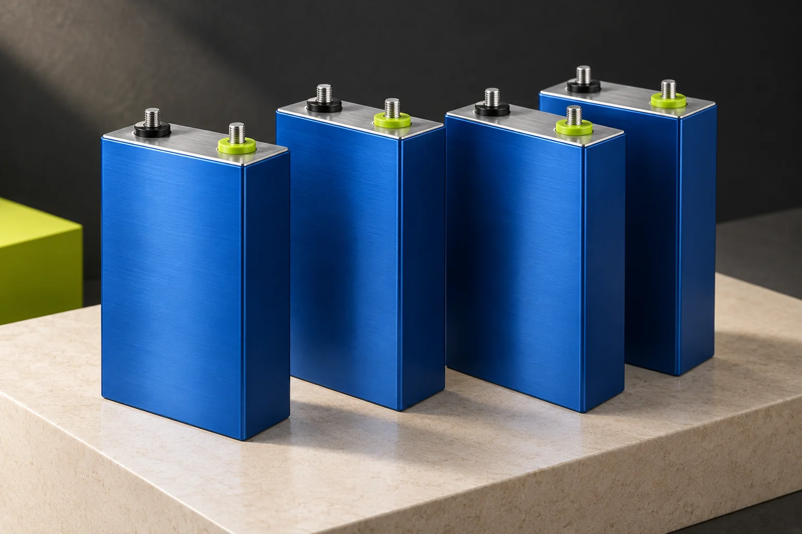

# VOLT Batteries

A responsive, five-page website for prismatic lithium batteries, built with **HTML, CSS, and vanilla JavaScript**. The site combines a light blue glass design with an interactive 3D battery, model pricing, a custom battery configurator, and a runtime estimator.

[View hosted website](https://volt-lithium-studio.gladolive16384.chatgpt.site/) · [Explore the code](https://github.com/HappyDeswal/VOLT_BATTERIES)

> The hosted Sites version may require ChatGPT sign-in. The source in this repository can run locally or on a static host without that integration.



## Features

- **Interactive 3D battery:** CSS-built geometry rotates slowly on the homepage. Hover pauses automatic rotation, slightly enlarges the battery, and follows cursor movement. Pause, reset, touch drag, and keyboard controls are included.
- **Model comparison:** switch between 12V 100Ah and 24V 100Ah, with synchronized specifications and prices.
- **Custom battery builder:** enter voltage and Ah, view nominal energy, save a build in the browser, download a summary, and carry the requirements into an enquiry.
- **Runtime estimator:** 12V, 24V, and 48V presets plus editable custom voltage/Ah, load presets, and usable-energy settings.
- **Contact page:** general queries and custom battery enquiries with validation, review, email draft, copy, and download options.
- **Responsive and accessible:** mobile layouts, semantic labels, visible keyboard focus, and reduced-motion support.
- **No build dependencies:** local assets, no framework, no package installation, and no tracking scripts.

## Pages

| Page | File | Purpose |
| --- | --- | --- |
| Home | `index.html` | 3D showcase, specifications, pricing, images, and general enquiry link |
| Models | `models.html` | Standard model comparison and interactive product viewer |
| Custom Build | `custom.html` | Voltage/Ah configuration and enquiry handoff |
| Runtime | `runtime.html` | Preset and custom battery runtime calculations |
| Contact | `contact.html` | General and custom battery enquiry forms |

## Standard models

| Model | Capacity | Calculated nominal energy | Price |
| --- | --- | --- | --- |
| 12V | 100Ah | 1,200Wh | ₹18,000 |
| 24V | 100Ah | 2,400Wh | ₹28,000 |

Prices are the owner-supplied amounts in Indian rupees. Tax and shipping terms are not specified. The 48V option is a runtime calculator preset; no 48V product price is listed.

## Run locally

```sh
git clone https://github.com/HappyDeswal/VOLT_BATTERIES.git
cd VOLT_BATTERIES
python3 -m http.server 8000
```

Open **http://localhost:8000** in a browser. Stop the server with `Ctrl+C`.

You can also open `index.html` directly. Using a local server is recommended for consistent browser behaviour, including clipboard features. No Node.js, npm, API key, or build command is required.

## Project structure

```text
VOLT_BATTERIES/
├── index.html
├── models.html
├── custom.html
├── runtime.html
├── contact.html
├── styles.css             # Layout, components, and CSS 3D geometry
├── theme.css              # Light blue glass appearance and responsive refinements
├── app.js                 # Animation, selection, forms, downloads, and calculators
├── assets/                # Locally hosted WebP images
├── docs/
│   ├── PRD.md             # Product requirements and revisions
│   └── IMAGE_PROMPTS.md   # Image provenance and generation prompts
├── .gitignore
└── .nojekyll
```

## Runtime calculation

```text
Nominal energy (Wh) = voltage (V) × capacity (Ah)
Estimated runtime (hours) = nominal energy × (usable energy % / 100) ÷ load (W)
```

At **100W** and **90% usable energy**:

| Configuration | Estimated runtime |
| --- | --- |
| 12V / 100Ah | 10.8 hours |
| 24V / 100Ah | 21.6 hours |
| 48V / 100Ah | 43.2 hours |
| Custom 48V / 200Ah | 86.4 hours |

The custom inputs support **12–48V** in 0.1V steps and **100–200Ah** in whole numbers. These are planning input ranges, not manufacturing limits or compatibility guarantees. Estimates assume a constant load and exclude system losses; actual runtime varies.

## Contact form delivery

The configured address, **contact@example.com**, is a non-receiving placeholder. Replace it with your own contact address before accepting real enquiries.

The form validates the visitor's details and prepares a reviewable enquiry. **Open demo email draft** opens a draft in the visitor's email app. With the placeholder address, enquiries will not reach the website owner. Copy and text-download options provide alternatives.

There is **no server-side form submission, email delivery service, submission database, or automatic delivery confirmation**. Contact details are not saved to browser storage. To change the recipient, update the address in `contact.html` and the `recipient` constant in `app.js`.

## Customization

- **Appearance:** edit the colour variables and glass styles in `theme.css`. The site uses a fixed light theme.
- **Prices:** update `modelPrices` in `app.js` and the initial price text in `index.html` and `models.html`.
- **Content:** edit the corresponding HTML page.
- **Images:** replace files in `assets/` and update image paths and alt text as needed.
- **Saved builds:** custom configurations and the selected standard model use browser `localStorage`; they do not sync across devices.

The homepage enquiry button links to a general contact form without prefilling a model. The custom builder and runtime calculator can pass a specific build using a URL such as `contact.html?type=custom&v=48&ah=200`.

## Deployment

Publish the **repository root** to any static host, including GitHub Pages. The entry file is `index.html`; there is no build step. Relative asset and page links support hosting under a repository subpath. The `.nojekyll` file allows the files to be served without Jekyll processing.

Pushing this repository does not itself enable GitHub Pages or change the existing Sites deployment.

## Product and image notes

VOLT is a working brand name. The owner has specified prismatic cells, model voltage/capacity, and the two standard prices. Product geometry and AI-generated images are illustrative. Chemistry, dimensions, charging/discharge limits, certifications, and warranty have not been verified. Final battery design and installation require appropriate review.

See [image prompts and provenance](docs/IMAGE_PROMPTS.md) and the [product requirements](docs/PRD.md) for more context.

## License

A license has not been specified for this repository.
